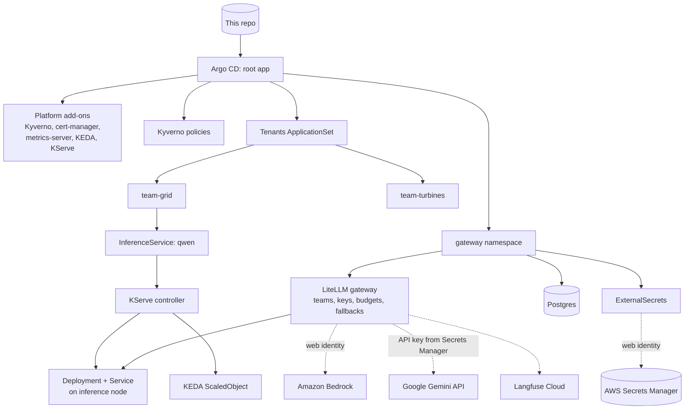

# mini-ai-platform
 
A small, GitOps-managed AI platform built on a local Kubernetes cluster, one lab at a time. Each lab adds a layer that an enterprise AI platform team would own: multi-tenant clusters, model serving, an LLM gateway, managed RAG, agents, observability and governance.
 
Everything in the cluster is declared in this repo and deployed by Argo CD. The only things applied by hand are the cluster itself, Argo CD, and the root Application.
 
## Status
 
| Lab | Topic | Status |
| --- | --- | --- |
| 1 | GitOps multi-tenant cluster | Done |
| 2 | Model serving with KServe and KEDA | Done |
| 3 | LLM gateway, secrets from AWS Secrets Manager, keyless AWS access | Done |
| 4 | Bedrock RAG with Guardrails | Blocked: AWS has Bedrock quotas at 0 on this account (support case open) |
| 5 | Kubernetes ops agent over MCP | Planned |
| 6 | OpenTelemetry for LLM workloads | Planned |
| 7 | Eval-gated canary and governance pack | Planned |
 
## How it fits together
 

 
## Repo layout
 
```
.devcontainer/          Codespace definition (4-core, 16 GB) and tool install script
clusters/kind/          kind cluster config and the root Argo CD Application
apps/                   One Argo CD Application per platform component (app-of-apps)
platform/policies/      Kyverno ClusterPolicies
platform/gateway/       Gateway namespace, Postgres, service accounts, SecretStore, ExternalSecrets
scripts/kind-oidc.sh    Turns the kind API server into a public OIDC issuer for AWS federation
tenants/base/           Shared tenant guardrails: quota, limit range, network policies
tenants/<team>/         One folder per tenant; adding a folder onboards a tenant
tenants/team-grid/models/   Models the team-grid tenant serves
labs/                   Test manifests used to verify each lab
governance/             Model cards and risk records (Lab 7)
```
 
## Running it
 
The lab runs in a GitHub Codespace, because the stack needs about 16 GB of RAM. Open a Codespace on `main`; the dev container installs Docker, kind, kubectl, Helm, Terraform, Python, the AWS CLI, the Argo CD CLI and k9s.
 
Bootstrap from an empty Codespace:
 
```bash
kind create cluster --config clusters/kind/kind-config.yaml
kubectl taint nodes -l pool=inference workload=inference:NoSchedule
 
helm repo add argo https://argoproj.github.io/argo-helm && helm repo update
helm upgrade --install argocd argo/argo-cd -n argocd --create-namespace \
  --set 'configs.params.server\.insecure=true' --wait
 
# Private repo only: give Argo CD read access (fine-grained token, Contents: Read-only)
kubectl -n argocd create secret generic repo-mini-ai-platform \
  --from-literal=type=git \
  --from-literal=url=https://github.com/agangwar07/mini-ai-platform \
  --from-literal=username=agangwar07 \
  --from-literal=password=<TOKEN>
kubectl -n argocd label secret repo-mini-ai-platform argocd.argoproj.io/secret-type=repository
 
kubectl apply -f clusters/kind/root.yaml
```
 
From Lab 3 onwards, the cluster must also be trusted by AWS. A new kind cluster has new signing keys, so after every cluster rebuild, re-point the API server at the issuer and republish its keys (values come from the git-ignored `.lab-env`; see Lab 3 for the one-time AWS setup):
 
```bash
source .lab-env
./scripts/kind-oidc.sh "$ISSUER"
kubectl get --raw /.well-known/openid-configuration > /tmp/discovery.json
kubectl get --raw /openid/v1/jwks > /tmp/jwks.json
aws s3 cp /tmp/discovery.json s3://$BUCKET/.well-known/openid-configuration --content-type application/json
aws s3 cp /tmp/jwks.json s3://$BUCKET/openid/v1/jwks --content-type application/json
```
 
Argo CD UI: `kubectl port-forward svc/argocd-server -n argocd 8080:80`, user `admin`, password from `argocd admin initial-password -n argocd`.
 
Stop the Codespace after each session, and delete it when the labs are finished, so it stays within the free monthly quota.
 
---
 
## Lab 1: GitOps multi-tenant cluster
 
### What was built
 
- **A 3-node kind cluster**: one control plane, one general worker (`pool=general`), and one worker labelled `pool=inference` and tainted `workload=inference:NoSchedule`. The tainted node stands in for a GPU node pool.
- **Argo CD in app-of-apps mode.** A single root Application points at `apps/`, and every platform component is an Application in that folder. Changing the platform means opening a pull request.
- **Tenants as folders.** An ApplicationSet with a Git directory generator turns every folder under `tenants/` (except `base`) into its own Argo CD Application. Two tenants exist: `team-grid` and `team-turbines`.
- **A shared tenant base (Kustomize)** that every tenant gets:
  - ResourceQuota for CPU, memory and pod count
  - LimitRange that defaults CPU and memory *requests* only
  - NetworkPolicies: default-deny ingress, allow traffic within the namespace, allow traffic from namespaces labelled `platform.io/role: gateway`
- **Kyverno policies**, scoped to namespaces labelled `platform.io/tenant`:
  - `require-limits`: every container must set CPU and memory limits
  - `disallow-latest-tag`: images must have an explicit tag that is not `:latest`
  - `route-inference-pods`: a mutate policy that adds the inference toleration and node selector to any pod labelled `platform.io/workload: inference`
### Design decisions
 
- **The LimitRange defaults requests but not limits**, so the scheduler always has requests to work with while the Kyverno policy still forces teams to choose their own limits.
- **Ingress-only default deny.** Tenants are isolated from each other; egress stays open to keep DNS and image pulls simple in the lab.
- **Inference routing as a paved road.** Tenants add one label and the platform handles tolerations and node selection, so GPU scheduling details never leak into tenant manifests.
- **Kyverno is installed with server-side apply**, because its CRDs are too large for client-side apply.
### Verification
 
| Test | Result |
| --- | --- |
| Pod with `nginx:latest` and no limits in `team-grid` | Rejected by Kyverno, naming both policies |
| `team-grid` pod calling a service in `team-turbines` | Timed out (blocked by NetworkPolicy) |
| Same call from inside `team-turbines` | Succeeded |
| Pod labelled `platform.io/workload: inference` | Scheduled on the `pool=inference` node with no toleration in its spec |
| `kubectl delete ns team-turbines` | Recreated by Argo CD self-heal |
 
Test manifests: `labs/lab1/test-pods.yaml`.
 
### Issues hit and how they were fixed
 
- **Argo CD could not read the private repo** ("Write access to repository not granted"). The fine-grained token was missing `Contents: Read-only` on this repository. Fixed the token scope and updated the repository secret.
- **Kyverno stayed OutOfSync while Healthy.** Kyverno injects its own conversion-webhook settings into its `policies.kyverno.io` CRDs at runtime, so they never match the chart. Added `ignoreDifferences` on `.spec.conversion` for CRDs, plus `RespectIgnoreDifferences=true`, in `apps/kyverno.yaml`.
### What changes in production
 
- AppProjects per tenant to restrict source repos, destination namespaces and cluster-scoped resources (the lab uses the `default` project)
- SSO for Argo CD with group-based RBAC, and a GitHub App instead of a personal token
- Default-deny egress through a firewall, not ingress only
- Node pools and taints defined in Terraform rather than by `kubectl taint`
- Policies rolled out in Audit mode before Enforce, with owned, time-limited exceptions
---
 
## Lab 2: Model serving with KServe and KEDA
 
### What was built
 
New platform add-ons, each an Argo CD Application in `apps/` with a pinned chart version:
 
| Component | Purpose |
| --- | --- |
| cert-manager | Issues TLS certificates for KServe's admission webhooks |
| metrics-server | Supplies CPU and memory metrics to HPAs and KEDA (`--kubelet-insecure-tls` for kind) |
| KEDA | Event-driven autoscaling; creates and drives HPAs from ScaledObjects |
| KServe `kserve-crd` | InferenceService, ServingRuntime and related CRDs |
| KServe `kserve-resources` | KServe controller and webhooks, in Standard deployment mode |
| KServe `kserve-runtime-configs` | ClusterServingRuntimes, including the Hugging Face runtime |
 
KServe's charts are published to an OCI registry (`ghcr.io/kserve/charts`), so `apps/kserve-oci-repo.yaml` registers that registry with Argo CD as an OCI-enabled Helm repository.
 
The `team-grid` tenant now serves a model from its own folder:
 
- **InferenceService `qwen`** (`tenants/team-grid/models/qwen.yaml`) serving `Qwen/Qwen2.5-0.5B-Instruct` with KServe's Hugging Face runtime on CPU (`--backend=huggingface`, `float32`, 2,048-token context).
- **The storage initializer** downloads the weights from Hugging Face (`hf://`) into the pod before the server starts.
- **OpenAI-compatible API** at `/openai/v1/chat/completions` on the `qwen-predictor` Service.
- **KEDA autoscaling**: the `serving.kserve.io/autoscalerClass: keda` annotation makes KServe create a ScaledObject that scales between 1 and 2 replicas at 60% average CPU.
- **Inference routing reused from Lab 1**: `predictor.labels` sets `platform.io/workload: inference`, so Kyverno places the model on the inference node.
- **A per-tenant quota override.** A Kustomize JSON patch raises `team-grid`'s quota (4 CPU and 8 GiB requests, 12 GiB memory limits) without changing the shared base.
- **ApplicationSet retries.** The tenant template now has `retry` and `SkipDryRunOnMissingResource=true`, so tenant apps tolerate resource types whose controllers are still starting.
### Design decisions
 
- **Standard mode rather than Knative mode.** It runs plain Deployments and HPAs with cert-manager as the only hard dependency. The trade-off: no built-in canary traffic splitting and no scale-to-zero. Canary releases move to the gateway (Labs 3 and 7).
- **CRDs, controller and runtimes as separate Applications**, so the controller can be upgraded without any risk of deleting CRDs, which would delete every InferenceService.
- **CPU-based scaling for now.** On a CPU-only model, CPU genuinely is the bottleneck. GPU-served models should scale on queue depth or running requests instead; Lab 6 switches to a Prometheus request metric.
- **Self-service model deployment.** The tenant ships a model by adding a manifest to its own folder; the platform supplies runtimes, routing and autoscaling.
### Verification
 
| Test | Result |
| --- | --- |
| All platform Applications | Synced and Healthy |
| `kubectl get clusterservingruntimes` | Hugging Face runtime present |
| `kubectl top nodes` | Metrics returned (metrics-server working) |
| `curl` and OpenAI Python SDK against `/openai/v1/chat/completions` | Valid completions with token usage |
| Model pod placement | On the `pool=inference` node |
| Load test (`labs/lab2/load.yaml`, 3 concurrent request loops) | KEDA scaled the model from 1 to 2 replicas; scaled back after the stabilisation window |
 
Measured cold start for a new replica: _add your measurement_.
 
### KServe compared with a hand-written vLLM Deployment
 
- **Gains:**
  - One InferenceService API for every model type
  - Runtime selection and model download built in
  - Autoscaling configured by annotation
  - OpenAI-compatible and KServe v1/v2 protocols
- **Costs:**
  - Another controller and set of CRDs to upgrade and secure
  - A layer between the platform and the serving engine's own flags and release cadence
  - No canary or scale-to-zero in Standard mode
### What changes in production
 
- GPU node pools with vLLM as the backend, scaling on vLLM metrics such as running or waiting requests
- Model weights cached on nodes or in a shared volume (KServe LocalModelCache) to cut cold starts, instead of downloading from Hugging Face on every start
- Model sources restricted to an internal registry or storage account, not the public Hugging Face Hub
- Tenant quotas sized from capacity plans and GPU availability, not fixed numbers
---
 
## Lab 3: LLM gateway with keyless cloud access
 
### What was built
 
**The gateway (`gateway` namespace, labelled `platform.io/role: gateway`):**
 
- **LiteLLM proxy**, deployed by Argo CD from its OCI Helm chart (`ghcr.io/berriai/litellm-helm`), with one OpenAI-compatible endpoint for every model.
- **Postgres** (a StatefulSet with a 2 GiB volume) holding LiteLLM's teams, keys and spend records. The chart's own migrations job creates the schema.
- **A model catalog of stable aliases.** Apps call the alias; the backend behind it can change without any app change.
| Alias | Backend | Notes |
| --- | --- | --- |
| `local-small` | KServe `qwen` in `team-grid` (Lab 2) | Given an internal per-token price so self-hosted usage shows up in chargeback |
| `bedrock-small` | Amazon Nova Micro via the `apac.` cross-region inference profile | Configured and authorised, but blocked by AWS on this account (see Issues) |
| `gemini-small` | `gemini-3.5-flash-lite` on the Gemini API free tier | Stand-in second provider while Bedrock is blocked |
 
- **Fallbacks:** `local-small` falls back to `gemini-small`, then `bedrock-small`. `bedrock-small` falls back to `gemini-small`.
- **Tenants as LiteLLM teams**, one key per application:
| Team | Models | Budget | Limits |
| --- | --- | --- | --- |
| `team-grid` | local-small, bedrock-small, gemini-small | $2 | 20,000 tokens/min, 60 requests/min |
| `team-turbines` | bedrock-small, gemini-small | $1 | 2,000 tokens/min, 3 requests/min |
 
- **Tracing** of every request to Langfuse Cloud through LiteLLM's `langfuse_otel` callback.
**Secrets: AWS Secrets Manager with External Secrets Operator:**
 
- One JSON secret, `mini-ai-platform/gateway/litellm`, holds the database credentials, LiteLLM master key, salt key, Langfuse keys and Gemini API key. Values were generated straight into Secrets Manager and never written to a file or to Git.
- External Secrets Operator (installed by Argo CD) syncs it every minute into the three Kubernetes Secrets the chart and Postgres expect: `litellm-db`, `litellm-masterkey`, `litellm-env`.
- The SecretStore is **namespaced to `gateway`**, so this namespace can only reach its own secret path.
**Keyless AWS access: workload identity federation outside EKS:**
 
- `scripts/kind-oidc.sh` makes the kind API server issue service account tokens for a public issuer URL. Its OIDC discovery document and JWKS are published to an S3 bucket that exposes only those two files.
- AWS IAM trusts that issuer as an OIDC identity provider. Two roles are each pinned to one service account (`sub`) and to the `sts.amazonaws.com` audience (`aud`):
| Role | Service account | Permissions |
| --- | --- | --- |
| `mini-ai-eso-gateway` | `gateway/eso-gateway` | Read secrets under `mini-ai-platform/gateway/` |
| `mini-ai-litellm-bedrock` | `gateway/litellm` | Invoke Nova Micro (model and inference profile) |
 
- ESO exchanges a short-lived token for `eso-gateway` with STS (the SecretStore's `jwt` auth). LiteLLM gets a projected service account token plus `AWS_ROLE_ARN` and `AWS_WEB_IDENTITY_TOKEN_FILE`, so the AWS SDK assumes its role by itself. This is exactly what IRSA injects on EKS, done by hand.
- **Result: no AWS access keys exist anywhere in the cluster, the repo or the gateway's secrets.**
### One-time AWS setup
 
Done with a temporary admin CLI profile, which was removed afterwards:
 
1. S3 bucket `mini-ai-oidc-<account-id>` (ap-south-1) with a bucket policy that makes only `.well-known/openid-configuration` and `openid/v1/jwks` public
2. IAM OIDC identity provider for the bucket URL, audience `sts.amazonaws.com`
3. The two roles above, with trust policies pinned to service accounts and inline least-privilege policies
4. The Secrets Manager secret `mini-ai-platform/gateway/litellm`
5. A $10 monthly AWS budget with an alert at 80%
### Design decisions
 
- **The gateway is the only path to models.** Lab 1's NetworkPolicy lets only the gateway namespace into tenant namespaces, so keys, limits, budgets and logs can't be bypassed.
- **Aliases instead of provider model names.** `bedrock-small` kept its name while its backend was blocked, and was served by Gemini through fallback. No app noticed.
- **Teams map to tenants; keys map to applications.** Limits and budgets live on the team; the key alias identifies the app in logs and traces.
- **Workload identities are owned by the platform layer.** The `litellm` and `eso-gateway` service accounts and their role annotations live in `platform/gateway/`, not in the chart, so the IAM-to-service-account mapping is reviewed in one place. This also fixed a hook-ordering bug (see Issues).
- **Namespaced SecretStore per namespace, not a cluster-wide store,** so a compromise in one namespace can't read another's secrets.
- **LiteLLM spend is the system of record for cost.** Langfuse records both the requested alias and the model that actually ran, which double-labels traffic in its cost view. Chargeback uses the gateway's per-team spend; Langfuse is for tracing and debugging.
### Verification
 
| Test | Result |
| --- | --- |
| STS `AssumeRoleWithWebIdentity` with a token for `gateway/eso-gateway` | Succeeded |
| Same role with a token for `team-turbines/default` | `AccessDenied` (trust policy pinned to one service account) |
| SecretStore and ExternalSecrets | `Valid` / `SecretSynced`; no `AWS_*` keys in any synced Secret |
| `/v1/models` per key | Each team sees only its own models |
| `team-turbines` key calling `local-small` | Rejected: model not allowed for the team |
| 5 rapid requests on the `team-turbines` key | 3 succeeded, then rate-limited; `team-grid` unaffected |
| `local-small` with `mock_testing_fallbacks` | Served by Gemini |
| `bedrock-small` while Bedrock is blocked | Served by Gemini through fallback (a real provider outage) |
| `team-turbines` pod calling the KServe model directly | Timed out (NetworkPolicy); the same pod reaches the gateway |
| Spend per team | Recorded per team, including the internal price for the self-hosted model |
| Langfuse | Every request traced, including the failed Bedrock attempt and the fallback |
| Master key rotated in Secrets Manager | Synced to the cluster within a minute; picked up after a rolling restart |
 
Test manifest: `labs/lab3/probe.yaml`.
 
### Issues hit and how they were fixed
 
- **Bedrock rejected every call with "Operation not allowed".** The same error appeared from an admin principal calling the AWS CLI directly, so it was the account, not the lab. Service Quotas showed the *applied* Nova Micro quotas at **0** (requests per minute, tokens per minute, tokens per day), against defaults of 400, 400,000 and 5.76 billion, in both ap-south-1 and us-east-1. The Bedrock Mantle endpoint also returned "model not available for this account" for GPT-5.6 Luna. A quota increase request and an AWS Support case were opened. Gemini was added as a stand-in, and `bedrock-small` stays configured so it works as soon as AWS lifts the hold.
- **LiteLLM's migrations job failed: "serviceaccount litellm not found".** The chart runs migrations as an Argo CD PreSync hook, which runs before the chart's regular resources, including the service account the chart was creating. Fixed by creating the service account in `platform/gateway/` (synced by an earlier app) and setting `serviceAccount.create: false` in the chart values.
- **The hook job hung in `Terminating` after the stuck sync was cancelled.** Argo CD puts a finalizer on hook resources and only removes it when the sync completes. Removed the finalizer by hand and started a fresh sync by patching the Application's `operation` field.
- **Langfuse showed six "models" for three backends.** LiteLLM reports both the alias the client requested and the provider model that served it. That's expected; see the cost decision above.
### What changes in production
 
**The gateway itself**
 
- Multiple replicas behind an internal load balancer, with a PodDisruptionBudget, and **Redis** so rate limits and budgets are shared across replicas. Without Redis, each replica enforces its own limits.
- Autoscaling on requests and tokens per second rather than CPU (the chart supports both through HPA or KEDA), with the replica ceiling sized against database connections.
- An explicit fail-open or fail-closed decision for when the gateway is down, since it sits in front of every AI app.
- Managed Postgres (Azure Database for PostgreSQL or RDS/Aurora) with Entra ID or IAM database authentication, backups and a read replica. The chart supports IAM and Entra auth, so there's no database password.
- A build-or-buy decision: LiteLLM open source or enterprise, Azure API Management's AI gateway features (token limits, semantic caching, load balancing across Azure OpenAI deployments), Envoy AI Gateway, Kong or Portkey.
**Identity and secrets**
 
- **On EKS,** IRSA or EKS Pod Identity replace the S3-hosted issuer and the hand-written token volume.
- **On AKS,** the built-in OIDC issuer is registered with AWS IAM the same way, and Entra Workload Identity gives keyless access to Azure OpenAI and Key Vault.
- **Federation first:** every provider that supports federated identity is called without keys; only SaaS providers that require API keys keep them, and those live in a secret manager with an owner and a rotation schedule.
- **Automatic restarts on rotation** with a tool such as Stakater Reloader, plus alerts on ExternalSecret sync failures.
- One SecretStore and IAM role per namespace, created by the same pipeline that onboards the tenant.
**Tenants, keys and access**
 
- Teams, keys and budgets managed as code (LiteLLM has a Terraform provider), not by API calls.
- SSO for the admin UI, with team membership mapped from Entra ID groups.
- Keys per application with expiry and rotation; no shared keys.
- Budgets that alert at thresholds rather than hard-stopping business-critical workloads, with an agreed escalation path.
**Network and data protection**
 
- Private connectivity to providers: VPC interface endpoints (PrivateLink) for Bedrock, private endpoints for Azure OpenAI, and an egress allow-list so models are reachable only through the gateway.
- Guardrails at the gateway: PII redaction, prompt-injection checks and content safety (Bedrock Guardrails, Azure AI Content Safety, or the gateway's own).
- Routing by data classification and region, so EU data stays on EU endpoints.
- Prompt and response logging with redaction, retention limits and access controls; in Germany, employee-data rules also apply to who may read logs.
- **No free-tier SaaS models.** The Gemini free tier allows the provider to use inputs and outputs to improve its models; enterprise traffic goes through paid tiers or cloud-hosted endpoints with data-processing terms.
**Provider capacity, the lesson from this lab**
 
- New cloud accounts can start with model quotas at **zero**, and raising them takes a support case. Quota and model-access checks belong in account and landing-zone onboarding, not in a project's first week.
- Request regional quotas ahead of demand, consider provisioned throughput for steady workloads, and keep a tested fallback to a second region or provider.
**Cost and model lifecycle**
 
- Gateway spend per team feeds finance for chargeback, with internal per-token prices for self-hosted GPU models.
- Response caching to cut repeat cost.
- Aliases are versioned. A model change behind an alias is released only after it passes the eval set (Lab 7).
- Provider deprecations are tracked. Gemini 2.5 was shut down in October 2026, which would have broken any app pinned to it; apps pinned to aliases are protected.