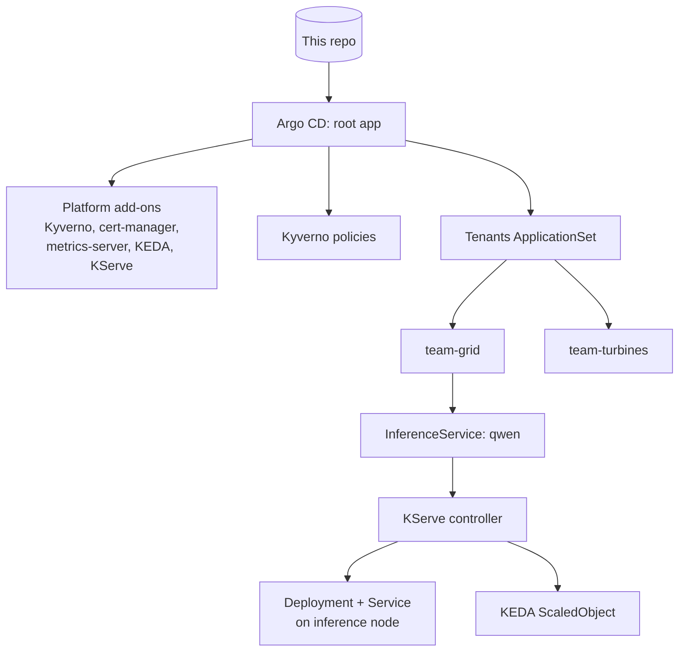

Claude
/
Ankit’s MacBook Neo, Connected
Setting up KServe on kind with Argo CD for a CPU model.
Setting up KServe on kind with Argo CD for a CPU model.
I’ll check the current KServe install method first, since its charts and deployment-mode names have changed across recent releases.

Searched the web, read 2 pages
Lab 2 is about serving a model the way a platform team would: one standard way to deploy any model, with autoscaling built in. As you asked, each manifest below comes with an explanation of what it does and why.

I checked the KServe docs first. The current release is v0.20.0, and it now calls the mode without Knative “Standard” (it used to be “RawDeployment”). In Standard mode the only hard dependency is cert-manager; KEDA is optional.

The technologies in this lab
KServe is a Kubernetes add-on for serving ML models. You don’t write a Deployment for each model; you write one InferenceService and KServe builds the rest. Its parts:

CRDs add new resource types to Kubernetes:
InferenceService describes a model you want served.
ClusterServingRuntime describes a model server (vLLM, Hugging Face, Triton, sklearn…) and which model formats it can serve.
The controller watches InferenceServices and creates the Deployment, Service and autoscaler for each one.
The storage initializer is an init container that downloads the model files (from Hugging Face, S3, Azure Blob…) into the pod before the server starts.
Deployment modes:
Knative mode adds scale-to-zero and canary traffic splitting, but needs Knative and Istio.
Standard mode uses plain Deployments and HPAs. It’s lighter and closer to how most enterprises run it, and it’s what we use here.
The Hugging Face runtime is the KServe model server for LLMs. It has two backends: vLLM (the default, fast, built for GPUs) and huggingface (plain transformers, slower, but runs fine on CPU). Either way it exposes an OpenAI-compatible API, so any OpenAI client can call it.

KEDA (Kubernetes Event-Driven Autoscaler) scales workloads on almost any signal: CPU, Prometheus queries, queue length and so on. You create a ScaledObject, and KEDA creates and drives an HPA for you. KServe can create that ScaledObject itself.

metrics-server collects CPU and memory usage from the kubelets. HPAs and KEDA need it for CPU-based scaling. On kind it needs --kubelet-insecure-tls because kind’s kubelet certificates are self-signed.

cert-manager issues and renews TLS certificates inside the cluster. KServe needs it for its admission webhook certificates.

OCI Helm charts: KServe publishes its charts to a container registry (ghcr.io) instead of a classic Helm repo. Argo CD needs a small repository entry with enableOCI turned on to read them.

Part 0: Clean up and collect chart versions
bash
cd /workspaces/mini-ai-platform
kubectl delete -f labs/lab1/test-pods.yaml --ignore-not-found

helm repo add jetstack https://charts.jetstack.io
helm repo add kedacore https://kedacore.github.io/charts
helm repo add metrics-server https://kubernetes-sigs.github.io/metrics-server/
helm repo update

CM_VER=$(helm search repo jetstack/cert-manager -o json | jq -r '.[] | select(.name=="jetstack/cert-manager") | .version')
KEDA_VER=$(helm search repo kedacore/keda -o json | jq -r '.[] | select(.name=="kedacore/keda") | .version')
MS_VER=$(helm search repo metrics-server/metrics-server -o json | jq -r '.[] | select(.name=="metrics-server/metrics-server") | .version')
KSERVE_VER=v0.20.0
echo "cert-manager=$CM_VER keda=$KEDA_VER metrics-server=$MS_VER kserve=$KSERVE_VER"
helm show chart oci://ghcr.io/kserve/charts/kserve-crd --version $KSERVE_VER | grep -E '^(name|version)'
This frees team-grid’s quota from Lab 1’s test pods and stores the latest chart versions in shell variables. The file blocks below fill those versions in automatically, so the charts stay pinned without any copy-pasting. Run Parts A and B in the same terminal so the variables still exist.

Part A: Platform add-ons (cert-manager, metrics-server, KEDA)
bash
cat > apps/cert-manager.yaml <<EOF
apiVersion: argoproj.io/v1alpha1
kind: Application
metadata:
  name: cert-manager
  namespace: argocd
spec:
  project: default
  source:
    repoURL: https://charts.jetstack.io
    chart: cert-manager
    targetRevision: ${CM_VER}
    helm:
      valuesObject:
        crds:
          enabled: true
  destination:
    server: https://kubernetes.default.svc
    namespace: cert-manager
  syncPolicy:
    automated: { prune: true, selfHeal: true }
    syncOptions: [CreateNamespace=true, ServerSideApply=true]
EOF

cat > apps/metrics-server.yaml <<EOF
apiVersion: argoproj.io/v1alpha1
kind: Application
metadata:
  name: metrics-server
  namespace: argocd
spec:
  project: default
  source:
    repoURL: https://kubernetes-sigs.github.io/metrics-server/
    chart: metrics-server
    targetRevision: ${MS_VER}
    helm:
      valuesObject:
        args:
          - --kubelet-insecure-tls
  destination:
    server: https://kubernetes.default.svc
    namespace: kube-system
  syncPolicy:
    automated: { prune: true, selfHeal: true }
EOF

cat > apps/keda.yaml <<EOF
apiVersion: argoproj.io/v1alpha1
kind: Application
metadata:
  name: keda
  namespace: argocd
spec:
  project: default
  source:
    repoURL: https://kedacore.github.io/charts
    chart: keda
    targetRevision: ${KEDA_VER}
  destination:
    server: https://kubernetes.default.svc
    namespace: keda
  syncPolicy:
    automated: { prune: true, selfHeal: true }
    syncOptions: [CreateNamespace=true, ServerSideApply=true]
EOF
What the key lines do:

helm.valuesObject is the same as a values.yaml or --set, written inline in the Application so the values are versioned in Git.
crds.enabled: true tells the cert-manager chart to install its own CRDs. Older guides apply them separately; this keeps everything in one app.
ServerSideApply=true is needed for cert-manager and KEDA because their CRDs are too large for client-side apply, the same reason as Kyverno in Lab 1.
namespace: kube-system for metrics-server: it’s cluster plumbing, so it lives with the other system components.
The <<EOF heredocs are unquoted (unlike Lab 1’s <<'EOF'), so the shell substitutes ${CM_VER} and the other versions as it writes the files.
Part B: KServe (CRDs, controller, runtimes)
bash
cat > apps/kserve-oci-repo.yaml <<'EOF'
apiVersion: v1
kind: Secret
metadata:
  name: repo-kserve-oci
  namespace: argocd
  labels:
    argocd.argoproj.io/secret-type: repository
stringData:
  type: helm
  name: kserve
  url: ghcr.io/kserve/charts
  enableOCI: "true"
EOF

cat > apps/kserve-crd.yaml <<EOF
apiVersion: argoproj.io/v1alpha1
kind: Application
metadata:
  name: kserve-crd
  namespace: argocd
spec:
  project: default
  source:
    repoURL: ghcr.io/kserve/charts
    chart: kserve-crd
    targetRevision: ${KSERVE_VER}
  destination:
    server: https://kubernetes.default.svc
    namespace: kserve
  syncPolicy:
    automated: { prune: true, selfHeal: true }
    syncOptions: [CreateNamespace=true, ServerSideApply=true]
EOF

cat > apps/kserve.yaml <<EOF
apiVersion: argoproj.io/v1alpha1
kind: Application
metadata:
  name: kserve
  namespace: argocd
spec:
  project: default
  source:
    repoURL: ghcr.io/kserve/charts
    chart: kserve-resources
    targetRevision: ${KSERVE_VER}
    helm:
      valuesObject:
        kserve:
          controller:
            deploymentMode: Standard
  destination:
    server: https://kubernetes.default.svc
    namespace: kserve
  syncPolicy:
    automated: { prune: true, selfHeal: true }
    syncOptions: [CreateNamespace=true, ServerSideApply=true]
    retry:
      limit: 10
      backoff: { duration: 30s, factor: 2, maxDuration: 5m }
EOF

cat > apps/kserve-runtimes.yaml <<EOF
apiVersion: argoproj.io/v1alpha1
kind: Application
metadata:
  name: kserve-runtimes
  namespace: argocd
spec:
  project: default
  source:
    repoURL: ghcr.io/kserve/charts
    chart: kserve-runtime-configs
    targetRevision: ${KSERVE_VER}
    helm:
      valuesObject:
        kserve:
          servingruntime:
            enabled: true
  destination:
    server: https://kubernetes.default.svc
    namespace: kserve
  syncPolicy:
    automated: { prune: true, selfHeal: true }
    syncOptions: [SkipDryRunOnMissingResource=true, ServerSideApply=true]
    retry:
      limit: 10
      backoff: { duration: 30s, factor: 2, maxDuration: 5m }
EOF
What the key lines do:

The Secret registers ghcr.io/kserve/charts with Argo CD as a Helm repo with enableOCI: "true". It holds no credentials (the charts are public), so it’s safe in Git. Private registries put credentials in the same kind of Secret, which would come from Key Vault or Secrets Manager rather than Git.
Three separate apps, mirroring KServe’s three charts:
kserve-crd holds the API types.
kserve (the kserve-resources chart) is the controller and webhooks.
kserve-runtimes holds the ClusterServingRuntimes.
Separating CRDs from the controller is standard practice. It means you can upgrade the controller without risking accidental CRD deletion, which would delete every InferenceService.
deploymentMode: Standard makes Standard the cluster-wide default, so you don’t need Knative or Istio.
retry covers start-up ordering. The KServe controller needs cert-manager to issue its webhook certificate first, and the runtimes need KServe’s CRDs. Argo CD retries until those exist.
SkipDryRunOnMissingResource=true lets the runtimes app sync even if the ClusterServingRuntime type doesn’t exist yet at dry-run time.
Push and watch:

bash
git add apps && git commit -m "Lab 2: cert-manager, metrics-server, KEDA, KServe" && git push
kubectl -n argocd annotate application root argocd.argoproj.io/refresh=hard --overwrite
watch kubectl get applications -n argocd
Check (5–10 min): all apps Synced and Healthy. Then:

bash
kubectl get pods -n kserve
kubectl get clusterservingruntimes
kubectl top nodes
You should see the KServe controller Running, a list of runtimes including one for Hugging Face, and CPU and memory figures from kubectl top, which proves metrics-server works.

If get clusterservingruntimes returns nothing, the runtimes chart uses a different values key in this version. Run helm show values oci://ghcr.io/kserve/charts/kserve-runtime-configs --version v0.20.0 | head -40 and paste me the output.

Part C: Let team-grid deploy a model
Two changes are needed: a bigger quota for this tenant, and retries in the tenant ApplicationSet so it tolerates the ordering.

bash
mkdir -p tenants/team-grid/models

cat > tenants/team-grid/kustomization.yaml <<'EOF'
apiVersion: kustomize.config.k8s.io/v1beta1
kind: Kustomization
namespace: team-grid
resources:
  - namespace.yaml
  - ../base
  - models/qwen.yaml
patches:
  - target:
      kind: ResourceQuota
      name: tenant-quota
    patch: |-
      - op: replace
        path: /spec/hard/requests.cpu
        value: "4"
      - op: replace
        path: /spec/hard/requests.memory
        value: 8Gi
      - op: replace
        path: /spec/hard/limits.memory
        value: 12Gi
EOF

cat > apps/tenants.yaml <<'EOF'
apiVersion: argoproj.io/v1alpha1
kind: ApplicationSet
metadata:
  name: tenants
  namespace: argocd
spec:
  goTemplate: true
  generators:
    - git:
        repoURL: https://github.com/agangwar07/mini-ai-platform
        revision: main
        directories:
          - path: tenants/*
          - path: tenants/base
            exclude: true
  template:
    metadata:
      name: 'tenant-{{.path.basename}}'
    spec:
      project: default
      source:
        repoURL: https://github.com/agangwar07/mini-ai-platform
        targetRevision: main
        path: '{{.path.path}}'
      destination:
        server: https://kubernetes.default.svc
      syncPolicy:
        automated: { prune: true, selfHeal: true }
        syncOptions: [SkipDryRunOnMissingResource=true]
        retry:
          limit: 10
          backoff: { duration: 30s, factor: 2, maxDuration: 5m }
EOF
What the key lines do:

patches is a Kustomize JSON patch. team-grid keeps the shared base but overrides three quota values, so only this tenant gets more room. This is how you handle “one team needs more” without forking the base. Two replicas of the model need about 2 CPU and 6 GiB in requests, which wouldn’t fit the original 4 GiB quota. That’s a real-world capacity conversation.
models/qwen.yaml is the tenant’s model, deployed from the tenant’s own folder: self-service model deployment through Git.
The ApplicationSet is the same as before, plus retry and SkipDryRunOnMissingResource, so tenant apps don’t fail when they contain a resource type (like InferenceService) whose controller is still starting.
Part D: The InferenceService
bash
cat > tenants/team-grid/models/qwen.yaml <<'EOF'
apiVersion: serving.kserve.io/v1beta1
kind: InferenceService
metadata:
  name: qwen
  annotations:
    serving.kserve.io/deploymentMode: Standard
    serving.kserve.io/autoscalerClass: keda
spec:
  predictor:
    labels:
      platform.io/workload: inference
    minReplicas: 1
    maxReplicas: 2
    autoScaling:
      metrics:
        - type: Resource
          resource:
            name: cpu
            target:
              type: Utilization
              averageUtilization: 60
    model:
      modelFormat:
        name: huggingface
      storageUri: hf://Qwen/Qwen2.5-0.5B-Instruct
      args:
        - --model_name=qwen
        - --backend=huggingface
        - --dtype=float32
        - --max_model_len=2048
      resources:
        requests:
          cpu: "1"
          memory: 3Gi
        limits:
          cpu: "2"
          memory: 4Gi
EOF

git add tenants apps/tenants.yaml && git commit -m "Lab 2: team-grid serves Qwen via KServe" && git push
kubectl -n argocd annotate application root argocd.argoproj.io/refresh=hard --overwrite
What each part does:

deploymentMode: Standard (annotation) is explicit per model, even though it’s the default.
autoscalerClass: keda makes KServe create a KEDA ScaledObject instead of a plain HPA.
predictor.labels are added to the model’s pods. platform.io/workload: inference triggers the Kyverno policy from Lab 1, which steers the pod to the inference node. The tenant never writes a toleration.
minReplicas / maxReplicas are the scaling bounds. Two keeps the Codespace within memory.
autoScaling.metrics scales when average CPU exceeds 60% of the request (1 CPU). On CPU-only inference, CPU really is the bottleneck. On GPUs it isn’t, which is why GPU serving scales on queue depth or running requests instead. We’ll switch to a Prometheus request metric in Lab 6.
modelFormat: huggingface tells KServe to pick the ClusterServingRuntime that supports this format.
storageUri: hf://… makes the storage initializer download this model from Hugging Face into the pod at /mnt/models.
args:
--model_name=qwen is the name clients use in API calls.
--backend=huggingface forces the CPU-friendly backend.
--dtype=float32 is the safest precision on CPU: about 2 GB of memory for 0.5B parameters.
--max_model_len=2048 caps the context window to bound memory use.
resources are required by your Kyverno policy, and they also feed the quota and the scaling percentage.
Watch it come up. The first start takes 5–10 minutes because the server image is large and the model has to download:

bash
kubectl -n team-grid get isvc qwen -w
Wait for READY to show True, then press Ctrl+C. If it’s stuck, check:

bash
kubectl -n team-grid describe isvc qwen | tail -20
kubectl -n team-grid get pods -o wide
kubectl -n team-grid logs -l serving.kserve.io/inferenceservice=qwen -c storage-initializer --tail=20
kubectl -n team-grid logs -l serving.kserve.io/inferenceservice=qwen -c kserve-container --tail=30
Part E: Call the model
bash
kubectl -n team-grid port-forward svc/qwen-predictor 8081:80 > /dev/null 2>&1 &

curl -s http://localhost:8081/openai/v1/chat/completions \
  -H "Content-Type: application/json" \
  -d '{"model":"qwen","messages":[{"role":"user","content":"In two sentences, what does a gas turbine do?"}],"max_tokens":80}' | jq
The same call from Python, using the standard OpenAI SDK:

bash
pip install --quiet openai
python - <<'EOF'
from openai import OpenAI
client = OpenAI(base_url="http://localhost:8081/openai/v1", api_key="not-needed")
r = client.chat.completions.create(
    model="qwen",
    messages=[{"role": "user", "content": "In two sentences, what does a gas turbine do?"}],
    max_tokens=80,
)
print(r.choices[0].message.content)
print(r.usage)
EOF
Notes:

qwen-predictor is the Service KServe created (<name>-predictor).
/openai/v1 is the OpenAI-compatible path. The SDK call is identical to calling OpenAI or Azure OpenAI apart from base_url, and that’s what makes the gateway in Lab 3 possible.
r.usage shows token counts, the unit you’ll meter per tenant later.
Also check where the pod landed:

bash
kubectl -n team-grid get pods -l serving.kserve.io/inferenceservice=qwen -o wide
It should be on platform-worker2.

Part F: Load it and watch it scale
bash
mkdir -p labs/lab2
cat > labs/lab2/load.yaml <<'EOF'
apiVersion: v1
kind: Pod
metadata:
  name: load
  namespace: team-grid
spec:
  restartPolicy: Never
  containers:
    - name: load
      image: curlimages/curl:8.11.1
      resources: { limits: { cpu: 200m, memory: 64Mi } }
      command: ["sh", "-c"]
      args:
        - |
          for i in 1 2 3; do
            while true; do
              curl -s -o /dev/null -w "%{http_code} %{time_total}s\n" \
                -H "Content-Type: application/json" \
                -d '{"model":"qwen","messages":[{"role":"user","content":"Explain a gas turbine in 100 words."}],"max_tokens":120}' \
                http://qwen-predictor/openai/v1/chat/completions
            done &
          done
          wait
EOF
kubectl apply -f labs/lab2/load.yaml
watch kubectl -n team-grid get scaledobject,hpa,pods
What the load pod does:

It runs three parallel loops sending chat requests to the model’s Service, so traffic is load-balanced across replicas. A port-forward would pin all traffic to one pod.
It runs inside team-grid, so the default-deny NetworkPolicy from Lab 1 allows it. A pod in another tenant would be blocked.
It has a pinned tag and limits, so Kyverno admits it.
What to watch:

The ScaledObject qwen-predictor shows READY True. KServe created it for you.
The HPA’s CPU figure climbs above 60%.
A second model pod appears, scheduled on the inference node. Time how long it takes to become Ready. That’s your cold start, the number that matters most when scaling LLMs.
Watch the load pod’s output with kubectl -n team-grid logs load -f. Response times should improve once the second replica is serving.
Then stop the load:

bash
kubectl delete -f labs/lab2/load.yaml
git add labs/lab2 && git commit -m "Lab 2 load test" && git push
The second replica disappears after about 5 minutes. That’s the HPA’s scale-down stabilisation window, which stops replicas flapping.

If no ScaledObject appears, check the KServe controller logs for KEDA errors and send them to me:

bash
kubectl -n kserve logs deploy/kserve-controller-manager --tail=50 | grep -i keda
What KServe gives you over a hand-written vLLM Deployment
This is the “Done when” question from the doc:

One API for every model: the same InferenceService for an LLM, a sklearn model or a Triton model. App teams learn one resource; the platform team owns the runtimes.
Runtime selection and model download built in: modelFormat picks the server and storageUri fetches the weights, so nobody hand-writes init containers or image tags.
Autoscaling wired in: one annotation and KServe creates the KEDA ScaledObject.
Standard protocols: OpenAI-compatible endpoints plus KServe’s v1 and v2 inference protocols, which makes gateways and clients interchangeable.
What it costs you:

Another controller and set of CRDs to upgrade and secure.
A layer between you and vLLM’s flags and release cadence.
In Standard mode, no built-in canary or scale-to-zero (those need Knative mode). Canaries move to the gateway instead, which is what we’ll do in Labs 3 and 7. That also makes step 6 in the doc’s P2 section, the canaryTrafficPercent stretch, a Knative-mode-only feature.
Send me the output from Part B’s check, Part E’s response, and what you saw in Part F, including the cold-start time. Then we’ll go on to Lab 3, the LLM gateway.

Lab2 is complete. Before we go to lab3, can you give me an update for readme file for both labs 1 and 2?
After every lab we are going to update readme detailing what has been done in that lab

Created a file, shared a file
The README.md covers both labs. For each one it lists what was built, the design decisions, the verification results, the two issues you hit in Lab 1 and how you fixed them, and what changes in production. It also has a status table and a diagram of how the pieces connect, which GitHub draws automatically.

To put it in your repo, open README.md in the Codespace, replace its contents with this file, and run:

bash
git add README.md && git commit -m "README: Labs 1 and 2" && git push
One thing to fill in: in the Lab 2 section, I left “Measured cold start” for you to add the number you saw during the load test.

I’ll update the README after each lab from now on.


Readme
Document·MD 


Claude is AI and can make mistakes.


Readme · MD
# mini-ai-platform
 
A small, GitOps-managed AI platform built on a local Kubernetes cluster, one lab at a time. Each lab adds a layer that an enterprise AI platform team would own: multi-tenant clusters, model serving, an LLM gateway, managed RAG, agents, observability and governance.
 
Everything in the cluster is declared in this repo and deployed by Argo CD. The only things applied by hand are the cluster itself, Argo CD, and the root Application.
 
## Status
 
| Lab | Topic | Status |
| --- | --- | --- |
| 1 | GitOps multi-tenant cluster | Done |
| 2 | Model serving with KServe and KEDA | Done |
| 3 | LLM gateway | Next |
| 4 | Bedrock RAG with Guardrails | Planned |
| 5 | Kubernetes ops agent over MCP | Planned |
| 6 | OpenTelemetry for LLM workloads | Planned |
| 7 | Eval-gated canary and governance pack | Planned |
 
## How it fits together
 

 
## Repo layout
 
```
.devcontainer/          Codespace definition (4-core, 16 GB) and tool install script
clusters/kind/          kind cluster config and the root Argo CD Application
apps/                   One Argo CD Application per platform component (app-of-apps)
platform/policies/      Kyverno ClusterPolicies
tenants/base/           Shared tenant guardrails: quota, limit range, network policies
tenants/<team>/         One folder per tenant; adding a folder onboards a tenant
tenants/team-grid/models/   Models the team-grid tenant serves
labs/                   Test manifests used to verify each lab
governance/             Model cards and risk records (Lab 7)
```
 
## Running it
 
The lab runs in a GitHub Codespace, because the stack needs about 16 GB of RAM. Open a Codespace on `main`; the dev container installs Docker, kind, kubectl, Helm, Terraform, Python, the AWS CLI, the Argo CD CLI and k9s.
 
Bootstrap from an empty Codespace:
 
```bash
kind create cluster --config clusters/kind/kind-config.yaml
kubectl taint nodes -l pool=inference workload=inference:NoSchedule
 
helm repo add argo https://argoproj.github.io/argo-helm && helm repo update
helm upgrade --install argocd argo/argo-cd -n argocd --create-namespace \
  --set 'configs.params.server\.insecure=true' --wait
 
# Private repo only: give Argo CD read access (fine-grained token, Contents: Read-only)
kubectl -n argocd create secret generic repo-mini-ai-platform \
  --from-literal=type=git \
  --from-literal=url=https://github.com/agangwar07/mini-ai-platform \
  --from-literal=username=agangwar07 \
  --from-literal=password=<TOKEN>
kubectl -n argocd label secret repo-mini-ai-platform argocd.argoproj.io/secret-type=repository
 
kubectl apply -f clusters/kind/root.yaml
```
 
Argo CD UI: `kubectl port-forward svc/argocd-server -n argocd 8080:80`, user `admin`, password from `argocd admin initial-password -n argocd`.
 
Stop the Codespace after each session, and delete it when the labs are finished, so it stays within the free monthly quota.
 
---
 
## Lab 1: GitOps multi-tenant cluster
 
### What was built
 
- **A 3-node kind cluster**: one control plane, one general worker (`pool=general`), and one worker labelled `pool=inference` and tainted `workload=inference:NoSchedule`. The tainted node stands in for a GPU node pool.
- **Argo CD in app-of-apps mode.** A single root Application points at `apps/`, and every platform component is an Application in that folder. Changing the platform means opening a pull request.
- **Tenants as folders.** An ApplicationSet with a Git directory generator turns every folder under `tenants/` (except `base`) into its own Argo CD Application. Two tenants exist: `team-grid` and `team-turbines`.
- **A shared tenant base (Kustomize)** that every tenant gets:
  - ResourceQuota for CPU, memory and pod count
  - LimitRange that defaults CPU and memory *requests* only
  - NetworkPolicies: default-deny ingress, allow traffic within the namespace, allow traffic from namespaces labelled `platform.io/role: gateway`
- **Kyverno policies**, scoped to namespaces labelled `platform.io/tenant`:
  - `require-limits`: every container must set CPU and memory limits
  - `disallow-latest-tag`: images must have an explicit tag that is not `:latest`
  - `route-inference-pods`: a mutate policy that adds the inference toleration and node selector to any pod labelled `platform.io/workload: inference`
### Design decisions
 
- **The LimitRange defaults requests but not limits**, so the scheduler always has requests to work with while the Kyverno policy still forces teams to choose their own limits.
- **Ingress-only default deny.** Tenants are isolated from each other; egress stays open to keep DNS and image pulls simple in the lab.
- **Inference routing as a paved road.** Tenants add one label and the platform handles tolerations and node selection, so GPU scheduling details never leak into tenant manifests.
- **Kyverno is installed with server-side apply**, because its CRDs are too large for client-side apply.
### Verification
 
| Test | Result |
| --- | --- |
| Pod with `nginx:latest` and no limits in `team-grid` | Rejected by Kyverno, naming both policies |
| `team-grid` pod calling a service in `team-turbines` | Timed out (blocked by NetworkPolicy) |
| Same call from inside `team-turbines` | Succeeded |
| Pod labelled `platform.io/workload: inference` | Scheduled on the `pool=inference` node with no toleration in its spec |
| `kubectl delete ns team-turbines` | Recreated by Argo CD self-heal |
 
Test manifests: `labs/lab1/test-pods.yaml`.
 
### Issues hit and how they were fixed
 
- **Argo CD could not read the private repo** ("Write access to repository not granted"). The fine-grained token was missing `Contents: Read-only` on this repository. Fixed the token scope and updated the repository secret.
- **Kyverno stayed OutOfSync while Healthy.** Kyverno injects its own conversion-webhook settings into its `policies.kyverno.io` CRDs at runtime, so they never match the chart. Added `ignoreDifferences` on `.spec.conversion` for CRDs, plus `RespectIgnoreDifferences=true`, in `apps/kyverno.yaml`.
### What changes in production
 
- AppProjects per tenant to restrict source repos, destination namespaces and cluster-scoped resources (the lab uses the `default` project)
- SSO for Argo CD with group-based RBAC, and a GitHub App instead of a personal token
- Default-deny egress through a firewall, not ingress only
- Node pools and taints defined in Terraform rather than by `kubectl taint`
- Policies rolled out in Audit mode before Enforce, with owned, time-limited exceptions
---
 
## Lab 2: Model serving with KServe and KEDA
 
### What was built
 
New platform add-ons, each an Argo CD Application in `apps/` with a pinned chart version:
 
| Component | Purpose |
| --- | --- |
| cert-manager | Issues TLS certificates for KServe's admission webhooks |
| metrics-server | Supplies CPU and memory metrics to HPAs and KEDA (`--kubelet-insecure-tls` for kind) |
| KEDA | Event-driven autoscaling; creates and drives HPAs from ScaledObjects |
| KServe `kserve-crd` | InferenceService, ServingRuntime and related CRDs |
| KServe `kserve-resources` | KServe controller and webhooks, in Standard deployment mode |
| KServe `kserve-runtime-configs` | ClusterServingRuntimes, including the Hugging Face runtime |
 
KServe's charts are published to an OCI registry (`ghcr.io/kserve/charts`), so `apps/kserve-oci-repo.yaml` registers that registry with Argo CD as an OCI-enabled Helm repository.
 
The `team-grid` tenant now serves a model from its own folder:
 
- **InferenceService `qwen`** (`tenants/team-grid/models/qwen.yaml`) serving `Qwen/Qwen2.5-0.5B-Instruct` with KServe's Hugging Face runtime on CPU (`--backend=huggingface`, `float32`, 2,048-token context).
- **The storage initializer** downloads the weights from Hugging Face (`hf://`) into the pod before the server starts.
- **OpenAI-compatible API** at `/openai/v1/chat/completions` on the `qwen-predictor` Service.
- **KEDA autoscaling**: the `serving.kserve.io/autoscalerClass: keda` annotation makes KServe create a ScaledObject that scales between 1 and 2 replicas at 60% average CPU.
- **Inference routing reused from Lab 1**: `predictor.labels` sets `platform.io/workload: inference`, so Kyverno places the model on the inference node.
- **A per-tenant quota override.** A Kustomize JSON patch raises `team-grid`'s quota (4 CPU and 8 GiB requests, 12 GiB memory limits) without changing the shared base.
- **ApplicationSet retries.** The tenant template now has `retry` and `SkipDryRunOnMissingResource=true`, so tenant apps tolerate resource types whose controllers are still starting.
### Design decisions
 
- **Standard mode rather than Knative mode.** It runs plain Deployments and HPAs with cert-manager as the only hard dependency. The trade-off: no built-in canary traffic splitting and no scale-to-zero. Canary releases move to the gateway (Labs 3 and 7).
- **CRDs, controller and runtimes as separate Applications**, so the controller can be upgraded without any risk of deleting CRDs, which would delete every InferenceService.
- **CPU-based scaling for now.** On a CPU-only model, CPU genuinely is the bottleneck. GPU-served models should scale on queue depth or running requests instead; Lab 6 switches to a Prometheus request metric.
- **Self-service model deployment.** The tenant ships a model by adding a manifest to its own folder; the platform supplies runtimes, routing and autoscaling.
### Verification
 
| Test | Result |
| --- | --- |
| All platform Applications | Synced and Healthy |
| `kubectl get clusterservingruntimes` | Hugging Face runtime present |
| `kubectl top nodes` | Metrics returned (metrics-server working) |
| `curl` and OpenAI Python SDK against `/openai/v1/chat/completions` | Valid completions with token usage |
| Model pod placement | On the `pool=inference` node |
| Load test (`labs/lab2/load.yaml`, 3 concurrent request loops) | KEDA scaled the model from 1 to 2 replicas; scaled back after the stabilisation window |
 
Measured cold start for a new replica: _add your measurement_.
 
### KServe compared with a hand-written vLLM Deployment
 
- **Gains:**
  - One InferenceService API for every model type
  - Runtime selection and model download built in
  - Autoscaling configured by annotation
  - OpenAI-compatible and KServe v1/v2 protocols
- **Costs:**
  - Another controller and set of CRDs to upgrade and secure
  - A layer between the platform and the serving engine's own flags and release cadence
  - No canary or scale-to-zero in Standard mode
### What changes in production
 
- GPU node pools with vLLM as the backend, scaling on vLLM metrics such as running or waiting requests
- Model weights cached on nodes or in a shared volume (KServe LocalModelCache) to cut cold starts, instead of downloading from Hugging Face on every start
- Model sources restricted to an internal registry or storage account, not the public Hugging Face Hub
- Tenant quotas sized from capacity plans and GPU availability, not fixed numbers
 

