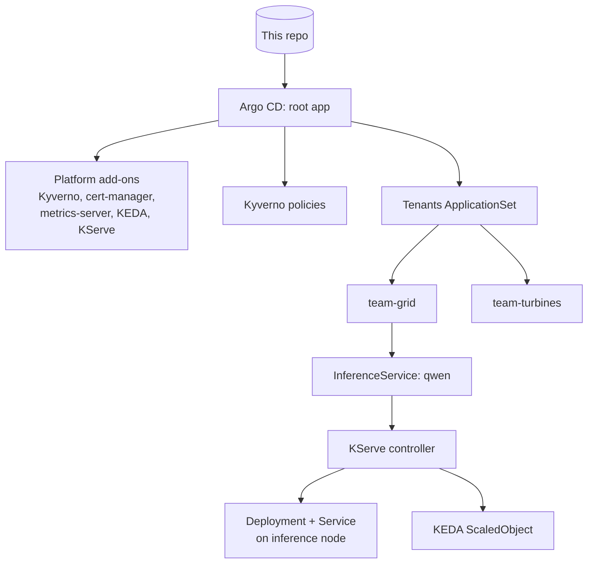

# mini-ai-platform
 
A small, GitOps-managed AI platform built on a local Kubernetes cluster, one lab at a time. Each lab adds a layer that an enterprise AI platform team would own: multi-tenant clusters, model serving, an LLM gateway, managed RAG, agents, observability and governance.
 
Everything in the cluster is declared in this repo and deployed by Argo CD. The only things applied by hand are the cluster itself, Argo CD, and the root Application.
 
## Status
 
| Lab | Topic | Status |
| --- | --- | --- |
| 1 | GitOps multi-tenant cluster | Done |
| 2 | Model serving with KServe and KEDA | Done |
| 3 | LLM gateway | Next |
| 4 | Bedrock RAG with Guardrails | Planned |
| 5 | Kubernetes ops agent over MCP | Planned |
| 6 | OpenTelemetry for LLM workloads | Planned |
| 7 | Eval-gated canary and governance pack | Planned |
 
## How it fits together
 

 
## Repo layout
 
```
.devcontainer/          Codespace definition (4-core, 16 GB) and tool install script
clusters/kind/          kind cluster config and the root Argo CD Application
apps/                   One Argo CD Application per platform component (app-of-apps)
platform/policies/      Kyverno ClusterPolicies
tenants/base/           Shared tenant guardrails: quota, limit range, network policies
tenants/<team>/         One folder per tenant; adding a folder onboards a tenant
tenants/team-grid/models/   Models the team-grid tenant serves
labs/                   Test manifests used to verify each lab
governance/             Model cards and risk records (Lab 7)
```
 
## Running it
 
The lab runs in a GitHub Codespace, because the stack needs about 16 GB of RAM. Open a Codespace on `main`; the dev container installs Docker, kind, kubectl, Helm, Terraform, Python, the AWS CLI, the Argo CD CLI and k9s.
 
Bootstrap from an empty Codespace:
 
```bash
kind create cluster --config clusters/kind/kind-config.yaml
kubectl taint nodes -l pool=inference workload=inference:NoSchedule
 
helm repo add argo https://argoproj.github.io/argo-helm && helm repo update
helm upgrade --install argocd argo/argo-cd -n argocd --create-namespace \
  --set 'configs.params.server\.insecure=true' --wait
 
# Private repo only: give Argo CD read access (fine-grained token, Contents: Read-only)
kubectl -n argocd create secret generic repo-mini-ai-platform \
  --from-literal=type=git \
  --from-literal=url=https://github.com/agangwar07/mini-ai-platform \
  --from-literal=username=agangwar07 \
  --from-literal=password=<TOKEN>
kubectl -n argocd label secret repo-mini-ai-platform argocd.argoproj.io/secret-type=repository
 
kubectl apply -f clusters/kind/root.yaml
```
 
Argo CD UI: `kubectl port-forward svc/argocd-server -n argocd 8080:80`, user `admin`, password from `argocd admin initial-password -n argocd`.
 
Stop the Codespace after each session, and delete it when the labs are finished, so it stays within the free monthly quota.
 
---
 
## Lab 1: GitOps multi-tenant cluster
 
### What was built
 
- **A 3-node kind cluster**: one control plane, one general worker (`pool=general`), and one worker labelled `pool=inference` and tainted `workload=inference:NoSchedule`. The tainted node stands in for a GPU node pool.
- **Argo CD in app-of-apps mode.** A single root Application points at `apps/`, and every platform component is an Application in that folder. Changing the platform means opening a pull request.
- **Tenants as folders.** An ApplicationSet with a Git directory generator turns every folder under `tenants/` (except `base`) into its own Argo CD Application. Two tenants exist: `team-grid` and `team-turbines`.
- **A shared tenant base (Kustomize)** that every tenant gets:
  - ResourceQuota for CPU, memory and pod count
  - LimitRange that defaults CPU and memory *requests* only
  - NetworkPolicies: default-deny ingress, allow traffic within the namespace, allow traffic from namespaces labelled `platform.io/role: gateway`
- **Kyverno policies**, scoped to namespaces labelled `platform.io/tenant`:
  - `require-limits`: every container must set CPU and memory limits
  - `disallow-latest-tag`: images must have an explicit tag that is not `:latest`
  - `route-inference-pods`: a mutate policy that adds the inference toleration and node selector to any pod labelled `platform.io/workload: inference`
### Design decisions
 
- **The LimitRange defaults requests but not limits**, so the scheduler always has requests to work with while the Kyverno policy still forces teams to choose their own limits.
- **Ingress-only default deny.** Tenants are isolated from each other; egress stays open to keep DNS and image pulls simple in the lab.
- **Inference routing as a paved road.** Tenants add one label and the platform handles tolerations and node selection, so GPU scheduling details never leak into tenant manifests.
- **Kyverno is installed with server-side apply**, because its CRDs are too large for client-side apply.
### Verification
 
| Test | Result |
| --- | --- |
| Pod with `nginx:latest` and no limits in `team-grid` | Rejected by Kyverno, naming both policies |
| `team-grid` pod calling a service in `team-turbines` | Timed out (blocked by NetworkPolicy) |
| Same call from inside `team-turbines` | Succeeded |
| Pod labelled `platform.io/workload: inference` | Scheduled on the `pool=inference` node with no toleration in its spec |
| `kubectl delete ns team-turbines` | Recreated by Argo CD self-heal |
 
Test manifests: `labs/lab1/test-pods.yaml`.
 
### Issues hit and how they were fixed
 
- **Argo CD could not read the private repo** ("Write access to repository not granted"). The fine-grained token was missing `Contents: Read-only` on this repository. Fixed the token scope and updated the repository secret.
- **Kyverno stayed OutOfSync while Healthy.** Kyverno injects its own conversion-webhook settings into its `policies.kyverno.io` CRDs at runtime, so they never match the chart. Added `ignoreDifferences` on `.spec.conversion` for CRDs, plus `RespectIgnoreDifferences=true`, in `apps/kyverno.yaml`.
### What changes in production
 
- AppProjects per tenant to restrict source repos, destination namespaces and cluster-scoped resources (the lab uses the `default` project)
- SSO for Argo CD with group-based RBAC, and a GitHub App instead of a personal token
- Default-deny egress through a firewall, not ingress only
- Node pools and taints defined in Terraform rather than by `kubectl taint`
- Policies rolled out in Audit mode before Enforce, with owned, time-limited exceptions
---
 
## Lab 2: Model serving with KServe and KEDA
 
### What was built
 
New platform add-ons, each an Argo CD Application in `apps/` with a pinned chart version:
 
| Component | Purpose |
| --- | --- |
| cert-manager | Issues TLS certificates for KServe's admission webhooks |
| metrics-server | Supplies CPU and memory metrics to HPAs and KEDA (`--kubelet-insecure-tls` for kind) |
| KEDA | Event-driven autoscaling; creates and drives HPAs from ScaledObjects |
| KServe `kserve-crd` | InferenceService, ServingRuntime and related CRDs |
| KServe `kserve-resources` | KServe controller and webhooks, in Standard deployment mode |
| KServe `kserve-runtime-configs` | ClusterServingRuntimes, including the Hugging Face runtime |
 
KServe's charts are published to an OCI registry (`ghcr.io/kserve/charts`), so `apps/kserve-oci-repo.yaml` registers that registry with Argo CD as an OCI-enabled Helm repository.
 
The `team-grid` tenant now serves a model from its own folder:
 
- **InferenceService `qwen`** (`tenants/team-grid/models/qwen.yaml`) serving `Qwen/Qwen2.5-0.5B-Instruct` with KServe's Hugging Face runtime on CPU (`--backend=huggingface`, `float32`, 2,048-token context).
- **The storage initializer** downloads the weights from Hugging Face (`hf://`) into the pod before the server starts.
- **OpenAI-compatible API** at `/openai/v1/chat/completions` on the `qwen-predictor` Service.
- **KEDA autoscaling**: the `serving.kserve.io/autoscalerClass: keda` annotation makes KServe create a ScaledObject that scales between 1 and 2 replicas at 60% average CPU.
- **Inference routing reused from Lab 1**: `predictor.labels` sets `platform.io/workload: inference`, so Kyverno places the model on the inference node.
- **A per-tenant quota override.** A Kustomize JSON patch raises `team-grid`'s quota (4 CPU and 8 GiB requests, 12 GiB memory limits) without changing the shared base.
- **ApplicationSet retries.** The tenant template now has `retry` and `SkipDryRunOnMissingResource=true`, so tenant apps tolerate resource types whose controllers are still starting.
### Design decisions
 
- **Standard mode rather than Knative mode.** It runs plain Deployments and HPAs with cert-manager as the only hard dependency. The trade-off: no built-in canary traffic splitting and no scale-to-zero. Canary releases move to the gateway (Labs 3 and 7).
- **CRDs, controller and runtimes as separate Applications**, so the controller can be upgraded without any risk of deleting CRDs, which would delete every InferenceService.
- **CPU-based scaling for now.** On a CPU-only model, CPU genuinely is the bottleneck. GPU-served models should scale on queue depth or running requests instead; Lab 6 switches to a Prometheus request metric.
- **Self-service model deployment.** The tenant ships a model by adding a manifest to its own folder; the platform supplies runtimes, routing and autoscaling.
### Verification
 
| Test | Result |
| --- | --- |
| All platform Applications | Synced and Healthy |
| `kubectl get clusterservingruntimes` | Hugging Face runtime present |
| `kubectl top nodes` | Metrics returned (metrics-server working) |
| `curl` and OpenAI Python SDK against `/openai/v1/chat/completions` | Valid completions with token usage |
| Model pod placement | On the `pool=inference` node |
| Load test (`labs/lab2/load.yaml`, 3 concurrent request loops) | KEDA scaled the model from 1 to 2 replicas; scaled back after the stabilisation window |
 
Measured cold start for a new replica: _add your measurement_.
 
### KServe compared with a hand-written vLLM Deployment
 
- **Gains:**
  - One InferenceService API for every model type
  - Runtime selection and model download built in
  - Autoscaling configured by annotation
  - OpenAI-compatible and KServe v1/v2 protocols
- **Costs:**
  - Another controller and set of CRDs to upgrade and secure
  - A layer between the platform and the serving engine's own flags and release cadence
  - No canary or scale-to-zero in Standard mode
### What changes in production
 
- GPU node pools with vLLM as the backend, scaling on vLLM metrics such as running or waiting requests
- Model weights cached on nodes or in a shared volume (KServe LocalModelCache) to cut cold starts, instead of downloading from Hugging Face on every start
- Model sources restricted to an internal registry or storage account, not the public Hugging Face Hub
- Tenant quotas sized from capacity plans and GPU availability, not fixed numbers
 

